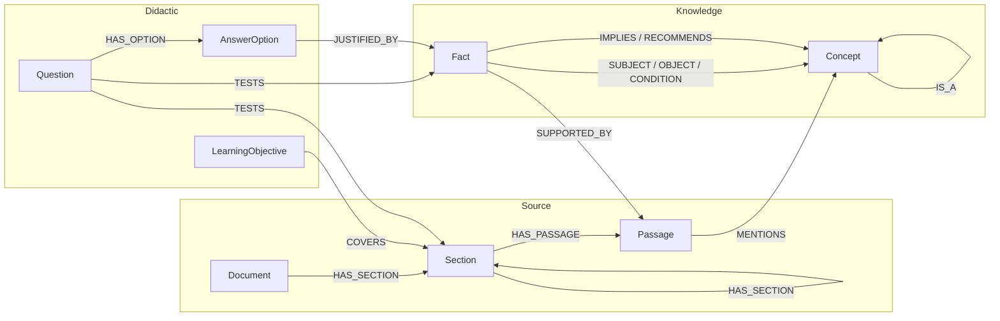
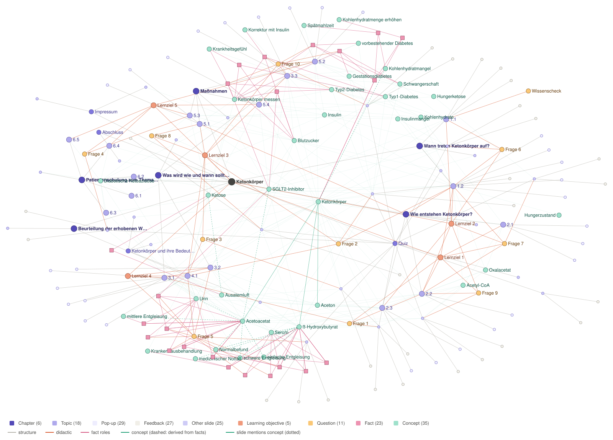
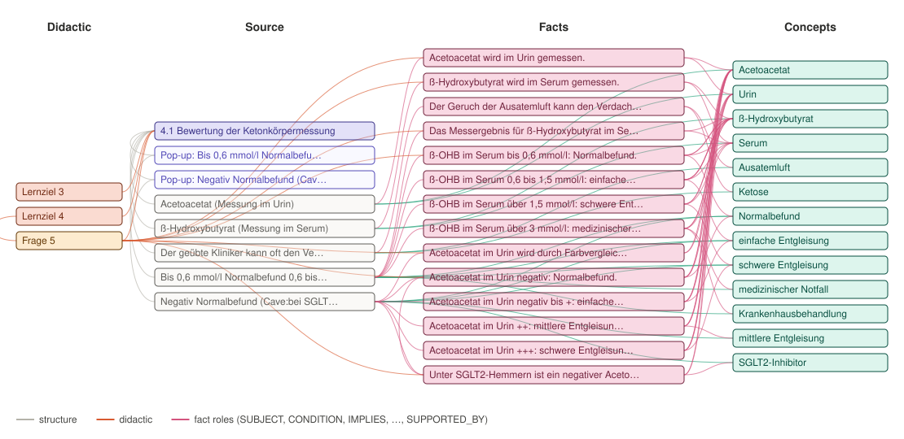

# 0007 – Graph Structure

**Status:** proposed; to be reviewed by the team and our supervisor. The formal schema follows in [#6](https://github.com/1BlauNitrox/e-learning-diabetologie/issues/6).

## Uses

| Use | What the graph must answer |
|---|---|
| Index | Where in the material is X explained? |
| Question generation | Which facts can be asked, in which question type, with which answer and source? |
| Question answering | Which facts answer a user's question, and which slide supports them? |
| Coverage and evaluation | Which facts and topics are tested by which questions, and which are not? |
| Further modules | New modules add to the same concepts instead of creating copies |

## Options

| Option | Strength | Why not chosen |
|---|---|---|
| Topics linked by "related" edges | Simple | The edge says nothing about *how* topics relate, so no question can be built from it |
| Tree following the module hierarchy | Mirrors the export | Concepts, objectives and questions have many parents (SGLT2 inhibitors appear in 9 topics) |
| **Layered graph with typed nodes and edges** | Keeps structure and content apart, linked by provenance | **Chosen** |

Within the layered graph, statements are stored as **fact nodes**, not as edges between concepts. An edge connects only two nodes and nothing can point at it, but a rule such as "Typ 2 + SGLT2 + BZ ≥ 200 + krank → messen" has four conditions, and a question must point at the exact fact it tests. In a test on slide 3.3, edges kept 3 of 8 statements completely and lost the context of the others; fact nodes kept all 8. Concept-to-concept edges are still available: they are derived from the facts.

## Structure



| Layer | Answers | Module-specific | Created by |
|---|---|---|---|
| Source | Where is it written? | Yes | Code, from the export |
| Didactic | What is to be learned and tested? | Yes | Code (questions) and mappings (objectives, tests) |
| Knowledge | What is true? | No, shared by all modules | LLM extraction plus review; by hand in the prototype |

### Nodes

| Node | Extra labels | Key properties | Example |
|---|---|---|---|
| `Document` | | `name` | Ketonkörper |
| `Section` | `Chapter`, `Part`, `Topic`, `Slide`, `Popup`, `Feedback` | `name`, `number`, `source_id` | 4.1 Bewertung der Ketonkörpermessung |
| `Passage` | | `text`, `source_id` | One text block of a layer: the smallest citable unit |
| `LearningObjective` | | `number`, `text` | Lernziel 4 |
| `Question` | | `number`, `type`, `origin` (`quiz`, `knowledge-check`, later `generated`), `text` | Frage 5 |
| `AnswerOption` | | `text` | "Nachweis im Urin" |
| `Concept` | `Substance`, `Condition`, `Drug`, `Specimen`, `Parameter`, `Nutrient`, `Grade`, `Action` | `name`, `aliases`, `rank` (grades), `normalized` | ß-Hydroxybutyrat, alias ß-OHB |
| `Fact` | | `kind`, `statement`, `predicate`, `modality`, `timing`, `review`, `method` | "ß-OHB im Serum über 3 mmol/l: medizinischer Notfall" |

### Edges

All edges are directed. Every edge that is not derived by code from the export names its `source`.

| Edge | From → To | Meaning |
|---|---|---|
| `HAS_SECTION {order}`, `HAS_PASSAGE {order}` | Document/Section → Section/Passage | Structure and reading order |
| `REFERS_TO` | Section → Section | Explicit reference in the text ("siehe nächstes Kapitel") |
| `HAS_OBJECTIVE`, `HAS_QUESTION` | Document → LearningObjective, Section → Question | Where objectives and questions are stated |
| `HAS_OPTION {order, correct, position, match}` | Question → AnswerOption | Options with the solution of each question type |
| `COVERS` | LearningObjective → Section | Topics that teach an objective |
| `ASSESSES` | Question → LearningObjective | Objectives a question checks |
| `TESTS` | Question → Section or Fact | What a question tests; the fact level is the precise one |
| `JUSTIFIED_BY` | AnswerOption → Fact | The fact that makes an option correct |
| `MENTIONS` | Passage → Concept | The index |
| `IS_A` | Concept → Concept | Taxonomy; source of comparisons and distractors |
| `SUBJECT`, `OBJECT` | Fact → Concept | What the fact is about |
| `CONDITION {operator, value, unit, alt_value, duration, text}` | Fact → Concept | When the fact holds; values are numbers |
| `IMPLIES`, `RECOMMENDS` | Fact → Concept (`Grade`, `Action`) | Consequence of a threshold or rule |
| `QUALIFIES`, `DEPENDS_ON` | Fact → Fact | A warning restricts a fact; a fact only applies in the context of another |
| `SUPPORTED_BY {quote}` | Fact or LearningObjective → Passage | Provenance with the verbatim quote |
| `MEASURED_IN`, `INDICATES`, `MAY_FALSIFY`, … `{fact, derived}` | Concept → Concept | Shortcuts derived from facts, for browsing; never edited by hand |

### Facts

- One fact is one citable statement. `kind`: `property`, `threshold`, `rule`, `warning`, `interpretation`, `recommendation`.
- All `CONDITION` edges of a fact hold together (AND). Alternatives (OR) are separate facts.
- `modality` keeps the strength of the text verbatim ("sollen", "sollte", "In Einzelfällen kann es auch erforderlich sein").
- `review` marks statements a domain expert has to check, e.g. an ambiguous boundary or an AND/OR the text does not state.
- `statement` is a German sentence close to the source; the exact wording is the `quote` on `SUPPORTED_BY`.

### Concept granularity

A concept gets its own node when the material says something that tells it apart from similar concepts. Concepts belong to no module.

| Case | Decision | Example |
|---|---|---|
| Members of a group are contrasted | Separate nodes plus `IS_A` | Acetoacetat, ß-Hydroxybutyrat, Aceton `IS_A` Ketonkörper |
| Abbreviations and spelling variants | One node with `aliases` | ß-Hydroxybutyrat / ß-OHB; SGLT2-Inhibitor / SGLT2-Hemmer |
| Steps on a scale | One `Grade` node each, ordered by `rank` | Normalbefund … medizinischer Notfall |
| Value ranges, durations | No node; values on `CONDITION` | > 250 mg/dl, länger als 6 Stunden |
| Verbal phrases | Noun concept marked `normalized` | "sich krank fühlt" → Krankheitsgefühl |

## Working with the graph

The paths are given as patterns; the same queries in Cypher are in [0008](0008-graph-tooling.md#spike).

**Index.** Where is a concept explained? Concept ← `MENTIONS` ← Passage ← `HAS_PASSAGE` ← Section.

**Question generation.** Start from a learning objective or topic, collect its facts through `COVERS` → `HAS_PASSAGE` ← `SUPPORTED_BY`, and choose a pattern by fact kind:

| Question type | Graph pattern | Prototype example |
|---|---|---|
| Factual / open | `statement` as model answer, passage as wording | "Wo wird Acetoacetat gemessen?" |
| Yes/no | True fact → yes; swap a value or a sibling concept → no | "Ist ein negativer Urinbefund unter SGLT2-Hemmern sicher normal?" (`QUALIFIES`) |
| Multiple choice | Correct: fact objects; distractors: `IS_A` siblings without that fact | Quiz question 1 |
| Comparative / matching | Siblings with the same predicate and different values | Quiz question 5 |
| Numeric | Threshold facts; distractors: other values of the same scale | "Ab welchem ß-OHB-Wert liegt ein Notfall vor?" |
| Case vignette | Rule facts: conditions become the patient, `RECOMMENDS` the answer | Quiz question 10 |
| Sequence | Ordered steps of a process | Quiz question 7 (no facts yet) |

A generated question is stored as `Question {origin: 'generated'}` with `TESTS` → its facts, so its answer can be checked and coverage measured.

**Question answering.** Find concepts in the user's question by `name` and `aliases`, follow their facts including conditions, and answer only from these facts with their `quote` and section. Value questions ("ß-OHB 2,0 mmol/l im Serum?") are answered by comparing the value with the `CONDITION` values of the threshold facts: the matching fact `IMPLIES` *schwere Entgleisung*. If nothing matches, the answer is "not covered by the material".

**Coverage.** `TESTS` shows untested material: 8 of 18 topics are not tested by the quiz (as in [0003 §3.6](0003-data-analysis.md#36-questions)), and 2 of 9 options of quiz question 5 have no fact on slide 4.1.

## Benefits

- **Traceable:** every fact leads to its slide and verbatim quote, as required for medical content ([0002](0002-project-scope.md#constraints)).
- **One graph, both directions:** the same facts generate questions and answer them.
- **Precise questions:** questions point at facts, so answers can be checked and gaps found.
- **Extensible:** a new module adds a source layer of its own and links to the shared concepts; nothing in the existing modules changes.

## Prototype

The prototype covers *Ketonkörper*: the full source and didactic layers (all 18 topics, 5 learning objectives, 11 questions), 35 concepts and 23 facts for slides 3.3 and 4.1 (590 nodes, 1021 edges). Names, mappings, concepts and facts are in `prototype/graph/manual.json`; everything else is derived from the extraction output.

```
python prototype/graph/build_graph.py data/extracted/ketonkoerper.json prototype/graph/output
python prototype/graph/draw_graph.py prototype/graph/output/graph.json docs/images
python -m unittest discover -s prototype/graph
```

`prototype/graph/output/graph.json` holds the nodes and edges, independent of any graph database. `MENTIONS` is computed by matching concept names and aliases in the passages.

**Whole module** without passages and answer options (184 nodes). `MENTIONS` is drawn from the slide that holds the passage. The two fact clusters sit next to topics 3.3 and 4.1; chapter 6 has no questions attached.



**Slide 4.1 across all layers:** learning objectives and the quiz question that test it, the slide's text blocks, the facts they support and the concepts of these facts.



## Open questions

- Does this structure support the question types our supervisor expects ([0002](0002-project-scope.md#open-questions))?
- Who reviews facts marked with `review`?
- How are concepts matched across modules (aliases, external terminology)? Decided in [#6](https://github.com/1BlauNitrox/e-learning-diabetologie/issues/6).
