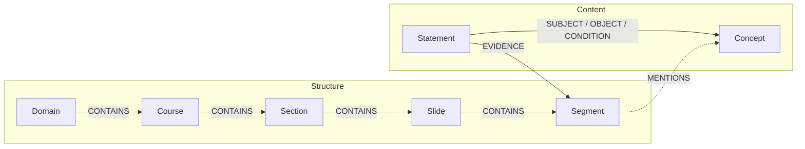

# Graph v2

**Status:** model under review ([#24](https://github.com/1BlauNitrox/e-learning-diabetologie/issues/24)). The prototype covers 9 of the 43 slides of *Ketonkörper*; it is mapped by hand and wasnt reviewed yet. [Graph v1](v1.md) is the baseline; both versions are compared with the [metric](metric.md) in [#25](https://github.com/1BlauNitrox/e-learning-diabetologie/issues/25).

## Idea

The graph has two layers that meet at one node type, the **segment**: the smallest citable unit of a slide (its base layer or one pop-up).

| Layer | Answers | Knows | Created by |
|---|---|---|---|
| Structure | Where is it written? | Courses, chapters, slides, segments. No medical content | Code, from the export |
| Content | What does the material state? | Medical concepts and statements about them. No courses, chapters or slides | LLM extraction into a closed model, checked by code; by hand in the prototype |



The layers are independent: without the structure layer, the content layer is still a valid set of medical statements; without the content layer, the structure layer is still a table of contents. Each can be built and checked on its own. Learning objectives and quiz questions are not part of the graph; they are the test set for the [metric](metric.md).

The model is closed: node types, edge types, concept types, predicates, modalities and operators are fixed lists. A validator rejects everything else, so an extractor only parses content into the model.

## Structure layer

A strict tree. Every level has one source in the Storyline export ([0003](../0003-data-analysis.md)).

| Node | Source in the export | Properties | Example | In *Ketonkörper* |
|---|---|---|---|---|
| `Domain` | Fixed | `title` | Diabetologie | 1 |
| `Course` | The export | `title` | Ketonkörper | 1 |
| `Section` | Scene | `title` (menu title), `chapter` (number, chapters only) | 2 Wie entstehen Ketonkörper? | 10, of which 6 chapters |
| `Slide` | Slide | `title` (menu title, else the first line of the base layer), `number` (chapter and position, content slides only) | 4.1 Bewertung der Ketonkörpermessung | 43 |
| `Segment` | Layer of a slide | `kind` (`base` or `popup`), `title` (slide title for a base layer, button label for a pop-up), `text` (cleaned text in reading order) | Pop-up *ß-Hydroxybutyrat (Serum)* on slide 4.1 | 72 (43 base, 29 pop-ups) |

Every node has an `id`, the Storyline ID where the export provides one.

Rules:

1. Every node has exactly one parent. A slide never belongs to two sections; relations between topics exist only in the content layer.
2. Titles are labels, not concepts. A title has no edges into the content layer.
3. Feedback layers are not segments. Quiz slides and frame slides (title, imprint, closing) are part of the tree but are not extracted.
4. A further course is a new `Course` subtree. Existing courses do not change.

## Content layer

### Concept

A medical term the material makes a statement about. Concepts belong to no course.

| Property | Content |
|---|---|
| `name` | The term of the source in its base form, German |
| `type` | One of the eight types below |
| `aliases` | Abbreviations, spelling variants and inflected or translated forms of the same word (ß-OHB; Zitratzyklus; SGLT2-Hemmer) |
| `unconfirmed_aliases` | Other words the mapper reads as the same concept; a domain expert has to confirm them (Glukosewerte for Blutzucker) |
| `normalized_from` | The verbatim phrase of the source, if the source has no noun for the concept ("sich krank fühlt" for Krankheitsgefühl) |

| `type` | Meaning | Examples in the prototype |
|---|---|---|
| `Substance` | Substance, metabolite | Acetoacetat, Acetyl-CoA, Laktat |
| `Process` | Metabolic process, mechanism | Lipolyse, Citratzyklus, osmotische Diurese |
| `Condition` | Disease, state, situation | Diabetische Ketoazidose, Schwangerschaft, Insulinmangel |
| `Drug` | Drug or drug class | SGLT2-Inhibitor, Metformin |
| `Test` | Test procedure or measured quantity | Ketonkörpermessung, Blutgasanalyse, Blutzucker |
| `Anatomy` | Organ, tissue or specimen | Gehirn, subcutanes Fettgewebe, Urin, Serum |
| `Finding` | Finding, grade of severity | Normalbefund, schwere Entgleisung, Krankheitsgefühl |
| `Intervention` | Measure, therapy | Krankenhausbehandlung, Spätmahlzeit, Ausgleich des Kaliumverlustes |

### Statement

One citable claim of the material: one predicate that relates one subject to one object, under zero or more conditions. Statements are nodes because an edge between two concepts cannot carry several conditions, and nothing can point at an edge.

| Property | Content |
|---|---|
| `id` | `S` and three digits. Carries no meaning and is never reused |
| `predicate` | One of the 16 predicates below |
| `category` | Category of the predicate; derived |
| `label` | "subject PREDICATE object"; derived |
| `text` | A German sentence close to the source, for reading. The exact wording is the quote on `EVIDENCE` |
| `modality` | The modal verb of the source sentence, if it has one: `muss`, `soll`, `sollte` or `kann` |
| `hedged` | `true` if the source limits the statement without naming a condition (ggf., evtl., meistens, oft, in Einzelfällen, bestimmte) |
| `timing` | When the statement applies, in the words of the source ("morgens nüchtern") |
| `from_context` | The roles (`subject`, `object`, `condition`) that the quote does not name, see [rule 8](#rules-for-extraction) |

Example from slide 4.1:

```
Statement S044   INDICATES   "ß-Hydroxybutyrat im Serum über 3 mmol/l: medizinischer Notfall."
├ SUBJECT {operator: ">", value: 3, unit: "mmol/l"}  →  Concept ß-Hydroxybutyrat (Substance)
├ CONDITION                                          →  Concept Serum (Anatomy)
├ OBJECT                                             →  Concept medizinischer Notfall (Finding)
└ EVIDENCE {quote: "Über 3 mmol/l  medizinischer Notfall"}  →  Segment 4.1, pop-up "ß-Hydroxybutyrat (Serum)"
```

### Predicates

Every predicate has a category and a signature: the concept types allowed as subject and as object.

| Category | Predicate | Subject → Object | Meaning | Example in the prototype |
|---|---|---|---|---|
| taxonomy | `IS_A` | same type → same type | The subject is a kind of the object | Acetoacetat → Ketonkörper |
| taxonomy | `PART_OF` | Process, Anatomy → Process, Anatomy | The subject is a step or part of the object | none yet |
| metabolism | `CONVERTED_TO` | Substance → Substance | The subject is turned into the object | Acetyl-CoA → Acetoacetat |
| metabolism | `PRODUCES` | Process → Substance | The process yields the substance | Lipolyse → Fettsäuren |
| metabolism | `CONSUMES` | Process → Substance | The process uses up the substance | Citratzyklus → Acetyl-CoA |
| metabolism | `REQUIRES` | Process → Substance | The process needs the substance to run | Citratzyklus → Oxalacetat |
| location | `LOCATED_IN` | Process, Substance → Anatomy | The subject takes place or is present there | Lipolyse → subcutanes Fettgewebe |
| location | `USED_IN` | Substance → Anatomy | The substance is used there | Ketonkörper → Gehirn |
| location | `EXCRETED_VIA` | Substance → Anatomy | The substance leaves the body this way | Aceton → Ausatemluft |
| diagnostics | `MEASURES` | Test → Substance | The test determines the substance | none yet |
| diagnostics | `MEASURED_IN` | Substance, Test → Anatomy | The specimen in which it is measured | ß-Hydroxybutyrat → Serum |
| diagnostics | `INDICATES` | Substance, Test, Finding → Finding, Condition | The observation, with its value, points to the object | ß-Hydroxybutyrat > 3 mmol/l → medizinischer Notfall |
| diagnostics | `INTERFERES_WITH` | Drug, Substance, Condition → Test | The subject can make the result of the test misleading | SGLT2-Inhibitor → Teststreifen |
| causation | `CAUSES` | Condition, Process, Drug, Substance → Condition, Process, Finding | The subject leads to the object | Insulinmangel → Ketose |
| causation | `INCREASES`, `DECREASES` | Condition, Process, Drug, Substance, Intervention → Substance, Test, Process | The subject raises or lowers the level or activity of the object | Insulinmangel `INCREASES` Blutzucker |
| recommendation | `INDICATION_FOR` | Condition, Finding → Test, Intervention, Drug | In this situation the test, measure or drug is to be used | Diabetische Ketoazidose → Ausgleich des Flüssigkeitsverlustes |

There is no `RELATED_TO`. A treatment is stated as `INDICATION_FOR` from the situation, so the same fact has one direction only.

## Edges

All edges are directed. Concepts are never connected directly: every relation between two concepts is a statement.

| Category | Edge | From → To | Per source node | Properties | Meaning |
|---|---|---|---|---|---|
| hierarchy | `CONTAINS` | Domain → Course → Section → Slide → Segment | any number | `order` | Structure and reading order |
| role | `SUBJECT` | Statement → Concept | exactly 1 | value constraint | What the statement is about |
| role | `OBJECT` | Statement → Concept | exactly 1 | none | What the predicate relates the subject to |
| role | `CONDITION` | Statement → Concept | 0 or more | value constraint | When the statement holds. All conditions of a statement hold together (AND) |
| link | `EVIDENCE` | Statement → Segment | 1 or more | `quote` | The passage that states it, verbatim |
| link | `MENTIONS` | Segment → Concept | any number | none | The index: the segment names the concept. Computed by matching `name` and `aliases` in the segment text |

A value constraint describes the value of the concept its edge points to. All properties are optional.

| Property | Content | Example |
|---|---|---|
| `operator`, `value` | `<`, `<=`, `>`, `>=`, `=` or `between`; a number or an ordinal result | `>` 250; `=` "++"; `=` "positiv" |
| `value_max` | Upper end of a `between` range | 0,6 `between` 1,5 |
| `unit` | Unit of the value | mmol/l |
| `alt` | The same value in a second unit, as written | "13,9 mmol/l" |
| `approx` | `true` if the source gives the value as approximate | "um oder über 200 mg/dl" |
| `duration` | How long the value must hold, in the words of the source | "länger als 6 Stunden" |
| `negated` | `true` if the concept must be absent | "kein SGLT2-Inhibitor" |
| `qualifier` | The words of the source, if it gives no value | "deutlich erhöht", "Verdacht" |

## Link between the layers

The layers touch only at the segment, through `EVIDENCE` and `MENTIONS`. Nothing is stored twice: there is no edge from a concept to a slide, a section or a course, because that is a query.

| Question | Path |
|---|---|
| Which statements does slide 4.1 make? | Slide → `CONTAINS` → Segment ← `EVIDENCE` ← Statement |
| In which chapter is a concept covered? | Concept ← role ← Statement → `EVIDENCE` → Segment ← `CONTAINS` ← Slide ← `CONTAINS` ← Section; `MENTIONS` also finds segments without a statement |
| What does ß-OHB 2,0 mmol/l in serum mean? | Concept ß-Hydroxybutyrat ← `SUBJECT` ← Statement with `INDICATES` and `CONDITION` → Serum; compare the value with the constraint; follow `OBJECT` |
| What links two slides? | The concepts their statements share: in the prototype 24 of 74 concepts occur on more than one slide |

## Rules for extraction

1. **Source only.** A statement says what its segment says. Its `quote` is verbatim and lies within one text block of the segment.
2. **One statement, one claim.** One predicate, one subject, one object. An enumeration gives one statement per item ("im Gehirn und in der Muskulatur" gives two). Alternatives (or) are separate statements. Subject and conditions hold together.
3. **Subject.** If the source names the actor (the cause, the converted substance, the measured value), that concept is the subject. If several concepts together trigger the object ("bei Typ2-Diabetes mit SGLT2-Inhibitoren und BZ über …"), the subject is the first one in reading order, starting with the segment title, whose type the predicate allows; the others are conditions.
4. **Values are never nodes.** A value, range or duration is a constraint on the role edge of the concept it measures.
5. **Concepts.** A concept gets a node only if a statement needs it. It is named as the source names it. A composite term stays one concept and is not taken apart ("Unterdrückung der Lipolyse"), because the source does not say who acts. A change of level that the source states is a statement with `INCREASES` or `DECREASES`, not a concept.
6. **Aliases.** Only abbreviations, spelling variants and inflected or translated forms of the same word are `aliases`. Any other merge is an `unconfirmed_alias`. Terms the material does not equate stay separate concepts.
7. **Normalised concepts.** A noun is formed only if the source has none, and the source phrase is kept in `normalized_from`.
8. **Context.** A role that the quote does not name may come only from the title of the segment, from the header of the table or list the quote stands in, from an earlier sentence of the same segment, or, for a pop-up, from the base layer of its slide. Such roles are listed in `from_context`.
9. **Identity.** Two passages support the same statement only if predicate, roles, value constraints, `modality`, `hedged` and `timing` are equal. Then the statement has two `EVIDENCE` edges. If they differ, they are two statements.
10. **No stretching.** A passage that fits no predicate, or only with concept types outside the signature, is not a statement. It is logged with a category and a reason. A pattern that recurs in the log is a reason to extend the predicate list as a new version of the model.
11. **Not extracted:** navigation and instructions, references to the module itself, restatements that only refer to other passages, statements that something is unknown, content that exists only in an image, quiz slides and feedback.

| Log category | Meaning | In the prototype |
|---|---|---|
| `no_predicate` | A relation between concepts that no predicate covers | 12 |
| `signature` | A predicate fits, but not with these concept types | 2 |
| `not_a_relation` | A property without a second concept, or a claim about another statement | 6 |
| `not_extracted` | Excluded by rule 11 | 5 |

## What v2 changes compared with v1

| Weakness of v1 | In v2 |
|---|---|
| Layers are not independent | Two layers with their own node types. The content layer has no reference to a course or slide; the only links are `EVIDENCE` and `MENTIONS` at the segment. Learning objectives and questions are outside the graph |
| The model is not strict | Closed lists for concept types, predicates with signatures, modalities and operators, and a closed set of properties. The validator rejects everything else. Free text remains in `text`, `timing`, `qualifier`, `duration` and `alt`; this is accepted, because these keep the words of the source and no query depends on them |
| The graph is chaotic | 7 node types and 6 edge types instead of 20 label combinations and 24 edge types. The viewer shows one slide or one layer at a time |
| Labels of content nodes are weak | A statement is labelled "subject PREDICATE object". A start slide carries the title of its chapter. Pop-up titles are the button labels; the extraction does not deliver them yet, see [Limits](#limits-and-open-points) |
| Unnecessary information is stored as nodes | No node per text block. Text is a property of the segment: 127 structure nodes for the whole module instead of the 461 nodes of v1's source layer |
| Some concepts are invented | Rule 7: a normalised concept keeps its source phrase, and the validator checks that the phrase occurs in the module. 6 of 74 concepts are normalised |
| Values sit on edges | Values stay on the role edge, with a defined set of properties: one edge holds a range (`between`, `value_max`) and marks an approximate value (`approx`) |
| Shortcut edges duplicate information | None. The compact view of the viewer draws a statement as an edge at display time only |

## Prototype

The prototype holds the structure layer of the whole module and the content layer of nine slides: 2.1 to 2.3, 3.3, 4.1 and 5.1 to 5.4.

| | Count |
|---|---|
| Nodes | 281: 127 structure, 74 concepts, 80 statements |
| Edges | 414: 126 `CONTAINS`, 80 `SUBJECT`, 80 `OBJECT`, 43 `CONDITION`, 85 `EVIDENCE` |
| Statements per category | recommendation 29, metabolism 15, diagnostics 15, causation 13, location 5, taxonomy 3 |
| Statements with conditions | 34; one has four |
| Role edges with a value constraint | 26 |
| Statements with `modality` / `hedged` / `timing` | 18 / 7 / 3 |
| Statements with a role from context | 41 |
| Statements with evidence on two slides | 3 |
| Passages in the log | 25 |

`prototype/graph/v2/statements.json` holds the concepts, the statements with their evidence, the titles of the pop-ups and the log (`not_mapped`). The builder derives the structure layer from the extraction output, checks the mapping against the model and writes nothing if it finds a problem.

```
python prototype/graph/v2/build_graph.py data/extracted/ketonkoerper.json prototype/graph/v2/output
python -m unittest discover -s prototype/graph/v2
```

| Output | Content |
|---|---|
| `output/graph.json` | Nodes and edges, independent of any graph database |
| `output/viewer.html` | Interactive view: one view per mapped slide across both layers, the structure layer, the content layer, and a compact content layer with every statement drawn as one edge. Opens in a browser without a server; needs a network connection for the drawing library ([tooling](tooling.md#decisions)) |

Not built yet: `MENTIONS`, the Neo4j load, and `Segment.text`. The text is left out of the committed files until it is clear whether course text may be published ([0002](../0002-project-scope.md#open-questions), question 2); the quotes are checked against the local extraction output.

## Limits and open points

Accepted in this version of the model:

- **A statement cannot refer to another statement.** The warning "Cave: bei SGLT2-Hemmern!" on slide 4.1 belongs to one row of a table; it is stored as its own statement (S050) and loses that link. v1 had `QUALIFIES` for this.
- **Equivalent wording gives two shapes.** "aus dem Abbau von Fettsäuren" is `PRODUCES` with a process (S003); "Fettsäuren … bis zum Acetyl-CoA abgebaut" is `CONVERTED_TO` with a substance (S007).
- **A general and a specific statement are not linked.** Slide 5.2 states an indication (S058); slide 3.3 states it with "sollen" and "morgens" (S034).
- **`INDICATION_FOR` carries 29 of 80 statements.** "is recommended" and "is the therapy" are not told apart.
- **Context is not checked by code.** 41 of 80 statements take a role from context (rule 8). The extraction does not yet deliver what a check needs: the button that opens a pop-up, the nesting of lists and the columns of tables.
- **Two type names are narrower than their meaning:** `Test` includes measured quantities (Blutzucker), `Anatomy` includes specimens (Urin, Ausatemluft).
- **Module-specific input:** the range of scenes that are chapters is a constant in the builder, and pop-up titles are assigned by hand.

Open questions:

- Unconfirmed aliases: Ketone = Ketonkörper, Zitronensäurezyklus = Citratzyklus, Glukosewerte = Blutzucker.
- Kept apart, because the material does not equate them: Acetessigsäure and Acetoacetat; Übersäuerung, Azidose and metabolische Azidose; Krankheitsgefühl and klinisch schlechterer Eindruck.
- Slide 4.1 assigns 0,6 mmol/l to two grades ("Bis 0,6" and "0,6 bis 1,5"); stored as written.
- Slide 3.3 lists two conditions for Typ1-Diabetes without saying whether one or both must hold; stored as alternatives.
- "ist das Coenzym für" is read as `REQUIRES` (S005, S006), and "Cave: bei SGLT2-Hemmern!" as `INTERFERES_WITH` (S050).
